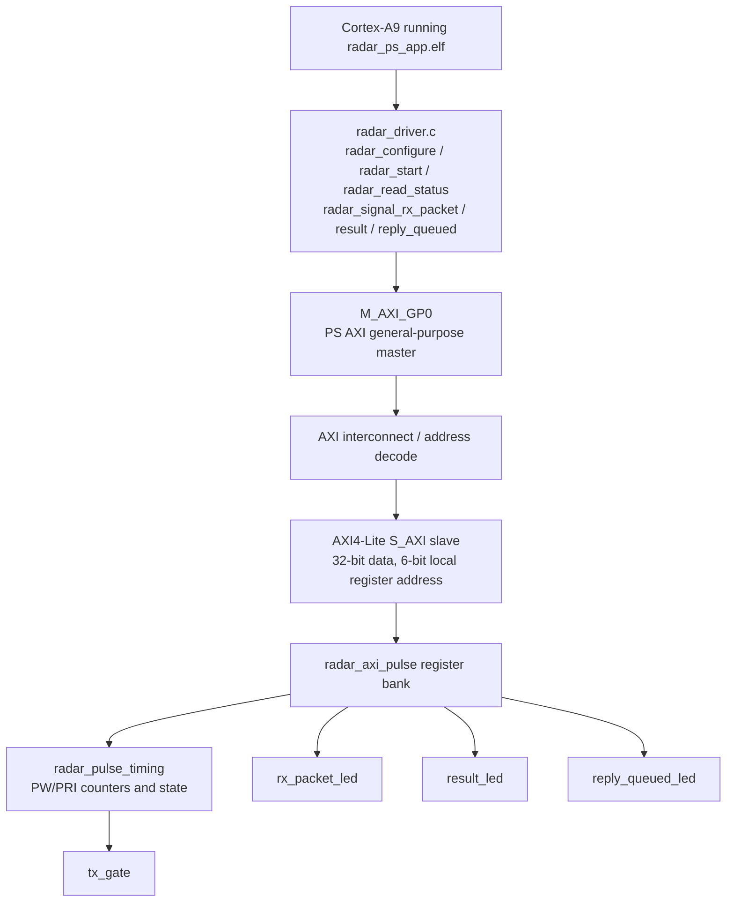
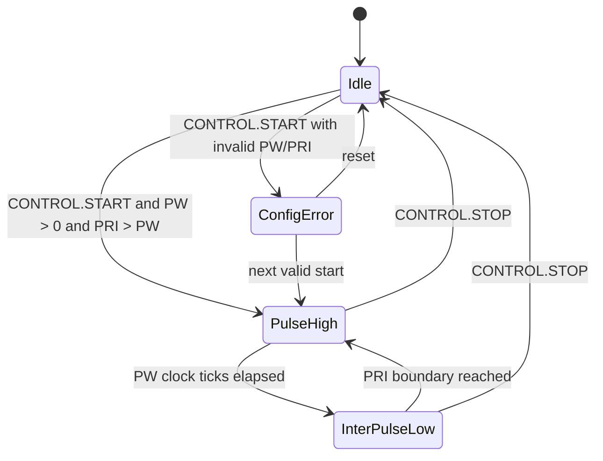
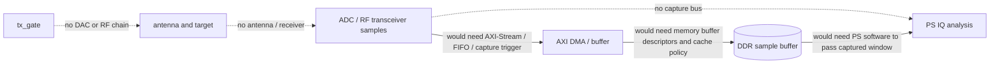

# Whole-project block diagram

This diagram documents the implementation in this repository and distinguishes it from hardware that is only planned. In particular, **there is no AXI DMA, PL sample stream, ADC capture chain, or RF transceiver in the current design**. IQ frames travel PC → Ethernet → Zynq PS memory → Cortex-A9 software; the PL handles a separate AXI-Lite pulse gate and event LEDs.

Legend:

- Solid arrows/boxes are paths present in the checked-in design.
- Dotted arrows/boxes are absent or future paths. They are included to make the current boundary clear.
- The hardware test uses generated digital IQ. It is not an RF measurement.

## 1. End-to-end system and physical links

```mermaid
flowchart LR
  subgraph HOST[PC host]
    BROWSER[Chrome dashboard<br/>127.0.0.1:8765]
    HTTP[Dashboard HTTP handler<br/>Start / Stop / state / live settings]
    SYNTH[Python IQ generator<br/>256 complex samples<br/>20 MHz sample model]
    VIS[Local metrics and plots<br/>waveform / filtered / residual / FFT]
    CODEC[RDR1 codec<br/>16-byte header + IQ payload + CRC-32]
    NIC[PC wired Ethernet NIC<br/>192.168.1.100/24]
    BROWSER --> HTTP
    HTTP --> SYNTH
    SYNTH --> VIS
    SYNTH --> CODEC
    CODEC --> NIC
    NIC --> BROWSER
  end

  subgraph BOARD[Digilent Zybo Z7-10 - Zynq-7000 XC7Z010]
    subgraph PS[Processing System - ARM Cortex-A9 / PS]
      PHYPORT[PS GEM0 Ethernet MAC<br/>lwIP adapter]
      POLL[Main loop polls xemacif_input]
      UDP[UDP PCB bound to port 5005]
      VALIDATE[RDR1 validation<br/>magic / version / length / CRC]
      CALLBACK[udp_receive callback<br/>dispatch by message type]
      IQCPU[CPU IQ analysis in PS RAM<br/>threshold / SNR / pulse regions]
      RESULT[JSON response builder<br/>ACK / DETECTION / ERROR]
      SEND[udp_sendto via lwIP]
      AXIDRV[radar_driver.c<br/>volatile AXI-Lite register accesses]
      DDR[(PS DDR / CPU address space<br/>pbufs and stack buffers)]
      PHYPORT --> POLL --> UDP --> VALIDATE --> CALLBACK
      CALLBACK --> IQCPU --> RESULT --> SEND --> PHYPORT
      UDP <--> DDR
      IQCPU <--> DDR
      CALLBACK --> AXIDRV
    end
    subgraph PL[Programmable Logic - FCLK_CLK0 = 100 MHz]
      GP[M_AXI_GP0 master from PS]
      INTERCONNECT[AXI SmartConnect / interconnect<br/>address decode and AXI-Lite routing]
      S_AXI[radar_axi_pulse S_AXI<br/>AXI4-Lite slave]
      REGS[Register bank<br/>0x40000000 segment, 4 KiB<br/>CONTROL / PW / PRI / STATUS / count / events]
      TIMING[radar_pulse_timing<br/>local-clock TX gate sequencer]
      TXG[tx_gate output]
      EV1[rx_packet_led event flasher]
      EV2[result_led event flasher]
      EV3[reply_queued_led event flasher]
      GP --> INTERCONNECT --> S_AXI --> REGS --> TIMING --> TXG
      REGS --> EV1
      REGS --> EV2
      REGS --> EV3
    end
    DDRAM[PS DDR pins]
  end

  NIC <-->|RDR1 UDP over direct Ethernet cable<br/>PC 192.168.1.100 ↔ board 192.168.1.10<br/>UDP destination port 5005| PHYPORT
  AXIDRV -->|CPU MMIO read/write<br/>M_AXI_GP0 → interconnect → S_AXI| GP
  TXG --> LED0[Board LED0<br/>M14]
  EV1 --> LED1[Board LED1<br/>M15]
  EV2 --> LED2[Board LED2<br/>G14]
  EV3 --> LED3[Board LED3<br/>D18]
  PS -.->|PS DDR controller| DDRAM

  ADCDMA[Future only: ADC / RF samples<br/>not present in this XSA] -. not connected .-> IQCPU
  AXIDMA[Future only: AXI DMA engine<br/>not instantiated in block design] -. not present .-> DDR
  RF[Future only: RF front end / ADC / DAC / antennas<br/>not present] -. no RF interface .-> TXG
```



### What the arrows mean

1. Dashboard **Start** opens one host UDP client, sends a `HELLO`, then repeatedly generates an IQ window, encodes it, sends `IQ_SAMPLES`, waits for the reply, and updates the browser state.
2. The board receives Ethernet through the Zybo Z7-10 PS GEM0 interface routed through PS MIO. The PS firmware calls `xemacif_input()` in its foreground loop; the lwIP callback handles received datagrams.
3. The ARM core copies each datagram into a bounded stack buffer, verifies the RDR1 framing and CRC, then processes IQ samples in software. It does not DMA samples into PL.
4. For an IQ frame, firmware records a PL LED event through AXI-Lite, calculates a software detection/range result, and submits a UDP reply through lwIP.
5. The AXI-Lite peripheral independently creates a deterministic pulse gate from its local 100 MHz PL clock. It does not receive the IQ payload and does not calculate range.

## 2. Zynq PS ↔ PL control path and register map



The block design allocates the custom peripheral at **base `0x40000000`, range `0x1000` (4 KiB)**. The HDL decodes these byte offsets:

| Byte offset | Register | Software use | Notes |
|---:|---|---|---|
| `0x00` | `CONTROL` | Write bit 0=start, bit 1=stop | One-cycle request pulse; stop wins in the timing core. |
| `0x04` | `PW_TICKS` | Read/write 32-bit | Gate high width in 100 MHz clock ticks. |
| `0x08` | `PRI_TICKS` | Read/write 32-bit | Pulse-start period in PL clock ticks; must exceed PW. |
| `0x0C` | `STATUS` | Read | bit 0 busy, bit 1 configuration error, bit 2 TX gate. |
| `0x10` | `PULSE_COUNT` | Read | Pulse-start count, wraps as 32-bit. |
| `0x14` | `RESULT_EVENT` | Write-only event | Starts the LED2 detection indicator. |
| `0x18` | `RX_EVENT` | Write-only event | Starts the LED1 frame-processed indicator. |
| `0x1C` | `REPLY_EVENT` | Write-only event | Starts the LED3 reply-queued indicator. |

The wrapper accepts AW and W independently, holds each side until both have completed a handshake, honors byte strobes for timing registers, and returns `SLVERR` for unsupported/unaligned accesses. Reads outside the implemented read registers return `SLVERR`. AXI and the pulse core share the same clock; there is no clock-domain crossing in this version.

**AXI DMA status:** neither `axi_dma`, AXI-Stream ports, an AXI BRAM sample buffer, nor an IQ-to-PL path appears in the block design or XSA. `M_AXI_GP0` is a memory-mapped control master, not a DMA data stream. The PS/PL connection is used for register reads/writes and the pulse/LED logic only.

## 3. RDR1 network packet and data-processing path

```mermaid
sequenceDiagram
  participant UI as Browser dashboard
  participant APP as Python dashboard / protocol.py
  participant NIC as PC NIC / Ethernet
  participant GEM as PS GEM0 + lwIP
  participant CPU as Cortex-A9 firmware
  participant AXI as AXI-Lite PL peripheral

  UI->>APP: Start + PC settings
  APP->>NIC: HELLO RDR1 UDP/5005
  NIC->>GEM: Ethernet frame to 192.168.1.10
  GEM->>CPU: xemacif_input → UDP callback
  CPU-->>NIC: ACK JSON status=ready
  loop Each IQ window
    APP->>APP: Generate I/Q and compute local charts
    APP->>NIC: IQ_SAMPLES RDR1 datagram
    NIC->>GEM: Ethernet frame
    GEM->>CPU: pbuf → udp_receive callback
    CPU->>CPU: Check header/CRC; calculate noise/threshold and pulse regions
    CPU->>AXI: MMIO write RX_EVENT
    alt Two qualified regions at expected samples
      CPU->>CPU: Calculate range from sample delta and 20 MHz rate
      CPU->>AXI: MMIO write RESULT_EVENT
      CPU->>AXI: MMIO write REPLY_EVENT after udp_sendto succeeds
      CPU-->>NIC: DETECTION JSON, hardware_capture=false
    else No matching two-pulse region
      CPU-->>NIC: ACK JSON status=noise_only
    end
    NIC-->>APP: UDP reply correlated by sequence
    APP-->>UI: Update plots, counters, and result fields
  end
```

### RDR1 datagram layout

```text
byte 0..3    magic = "RDR1"
byte 4       protocol version = 1
byte 5       message type
byte 6..7    flags (network byte order; currently 0)
byte 8..11   sequence number (uint32, network byte order)
byte 12..15  payload length (uint32, network byte order)
byte 16..    payload bytes
last 4       CRC-32 over header + payload (network byte order)
```

The protocol caps one UDP datagram at 1400 bytes. A full IQ pair is four bytes: signed 16-bit I followed by signed 16-bit Q, both network byte order. A 256-sample dashboard IQ payload is 1024 bytes, plus the 16-byte header and 4-byte CRC = **1044 bytes** total. There is no fragmentation for this capture.

## 4. PL timing block and physical indicators



At the configured 100 MHz `FCLK_CLK0`, the PS app writes `PW=10,000,000` and `PRI=20,000,000` ticks at startup. That means the TX gate is high for 100 ms, has one leading edge every 200 ms, and repeats at 5 Hz. This is a digital timing output connected to LED0 on this design; it is not a modulated RF transmit signal.

Each event LED sequencer is clocked at 100 MHz. Its default phase is 10,000,000 ticks, or 100 ms. A one-pulse event produces a 100 ms on phase and a 100 ms off phase. Events received while that LED sequencer is already active are not queued; rapid frame events can therefore merge or be missed visually. The software LED state is not returned to the browser as physical telemetry.

| Board indicator | FPGA top-level output | Pin / board LED | Event meaning |
|---|---|---|---|
| LED0 | `tx_gate` | M14 | PL pulse sequencer output; periodic at startup. |
| LED1 | `rx_packet_led` | M15 | Firmware examined an IQ frame (also occurs on noise-only). |
| LED2 | `result_led` | G14 | Firmware found a qualified two-pulse IQ detection. |
| LED3 | `reply_queued_led` | D18 | lwIP accepted `udp_sendto`; does not independently prove PC reception. |

The PC dashboard indicators mirror returned UDP result fields. They do not read the four physical LEDs.

## 5. Not implemented in the present design



These are future engineering blocks, not hidden or already-connected features. The current host creates synthetic IQ samples; the PS firmware searches those supplied samples for the TX-reference region at index 0 and the echo region at the configured delay. Until real ADC samples are captured, aligned to the transmit timing, and passed into an actual PL/PS receive path, returned metres are a calculation on a digital test vector rather than a target measurement.
